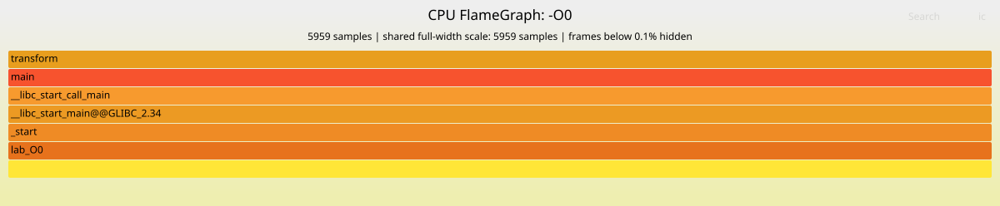
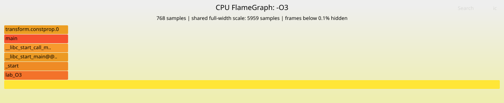

# Профілювання та оптимізація C-програми

Порівняно дві збірки [однієї програми](src/main.c): `-O0` і `-O3`. Програма 8000 разів перетворює масив із 1 048 576 чисел:

```c
out[i] = (in[i] * 1664525u + 1013904223u) ^ (in[i] >> 7);
```

Результат кожного проходу використовується в наступному. Контрольна сума в обох збірках однакова: **2250868073266871**.

Вимірювання виконано на NVIDIA Jetson, ARM Cortex-A78AE, Ubuntu 22.04.5, GCC 11.4.0. Для часу, лічильників і енергії зроблено по три окремі повтори; нижче наведено медіани. Частоти автоматичні, фонові служби працювали.

## 1. FlameGraph

Графіки отримано за схемою: `perf record` → `perf script` → `stackcollapse-perf.pl` → `flamegraph.pl`. Записувалися стеки DWARF з подією `cpu-clock` і цільовою частотою 199 Гц. Код побудови — [profile.sh](scripts/profile.sh).

**До оптимізації:**



**Після оптимізації:**



Ширина блока — кількість вибірок у спільному масштабі: повна ширина відповідає 5959 вибіркам. Висота — вкладеність викликів. Вісь X не показує послідовність у часі, колір не позначає навантаження.

Майже весь час займає `transform`. Після оптимізації це `transform.constprop.0` — спеціалізована версія тієї самої функції. Вибірок стало **768 замість 5959**, втрачених немає. Тому блок O3 займає близько **12,9% ширини O0**. За однакової частоти вибірок це показує скорочення часу CPU. Точне прискорення визначено окремо через GNU time. Кадри менші за 0,1% спільної шкали приховано для читабельності; первинні стеки збережено повністю.

## 2. Статистика виконання

| Показник | -O0 | -O3 |
|---|---:|---:|
| Час виконання, с | 29,84 | 3,87 |
| User time, с | 29,77 | 3,84 |
| Максимальна RAM, KiB | 9040 | 9036 |
| Такти, млрд | 59,19 | 7,61 |
| Інструкції, млрд | 251,77 | 18,89 |
| IPC — інструкцій за такт | 4,25 | 2,48 |
| Промахи L1, млн | 127,15 | 65,06 |
| Промахи LLC, млн | 674,99 | 423,44 |

**`/usr/bin/time --verbose`.** Elapsed — повний час запуску, user — час CPU у програмі, system — у ядрі. Завантаження близько 100% відповідає одному ядру. Пам’ять майже не змінилася: обидві збірки використовують ті самі два масиви. Major page faults і swaps — 0. [Звіт O0](results/O0_time1.txt), [звіт O3](results/O3_time1.txt).

**`perf stat -d`.** Після оптимізації виконано значно менше інструкцій і тактів. IPC нижчий, але програма швидша: одна SIMD-інструкція обробляє кілька чисел. Лічильник `branches` не підтримується цим процесором. [Звіт O0](results/O0_stat1.txt), [звіт O3](results/O3_stat1.txt).

**`perf report` після `perf record`.** Self показує частку подій у самій функції, Children — разом із викликаними функціями. Для `transform` Self становить **99,98%**, для оптимізованої версії — **100%**. Отже, основне навантаження в обох випадках — перетворення масиву. [Профіль O0](results/O0_report.txt), [профіль O3](results/O3_report.txt).

## 3. Енерговитрати

Датчик INA3221 вимірював напругу і струм каналу `VDD_IN` приблизно кожні 50 мс. Потужність обчислено як `P = U × I`, енергію — інтегруванням потужності за часом методом трапецій.

Це енергія **модуля Jetson**, без втрат блока живлення та зовнішніх пристроїв. Внесок програми оцінено відніманням фону:

```text
Pфон = (Pдо + Pпісля) / 2
Eпрограми ≈ Eмодуля − Pфон × час виконання
```

Фон вимірювався по 8 секунд до й після запуску. Це оцінка, а не пряме вимірювання енергії окремого процесу: фонові задачі та зміна частот впливають на результат. [Код вимірювання](scripts/energy.py), [первинні дані](results/).

## 4. Результат оптимізації

### Асемблер і SIMD

У [збірці O0](asm/lab_O0.s) цикл обробляє по одному числу й багаторазово читає індекс та вказівники зі стека. У [збірці O3](asm/lab_O3.s) константи винесено з циклу, індекс зберігається в регістрі, обчислення векторизовано:

```asm
ldr  q0, [x1, x2]          // завантажити 4 числа
mla  v1.4s, v0.4s, v3.4s   // множення з додаванням для 4 чисел
ushr v0.4s, v0.4s, 7       // зсув вправо
eor  v0.16b, v1.16b, v0.16b // XOR
str  q0, [x0, x2]          // записати 4 результати
```

Це 128-бітний **ARM NEON**. AVX тут не застосовується, бо Jetson має архітектуру ARM, а AVX належить до x86. Прискорення отримано завдяки SIMD і скороченню зайвих операцій у циклі.

### Час і енергія

Час зменшився з **29,84 до 3,87 с — у 7,71 раза**. Результат обчислень залишився тим самим. Зміни профілю показані на FlameGraph у пункті 1.

| Показник | -O0 | -O3 |
|---|---:|---:|
| Середня потужність модуля, Вт | 8,43 | 8,97 |
| Енергія модуля за запуск, Дж | 251,85 | 35,14 |
| Додаткова енергія програми, оцінка, Дж | 61,53 | 9,71 |

Потужність трохи зросла, але програма працювала набагато менше часу. Тому енергія модуля зменшилася приблизно на **86%**.

Оцінка енергії програми коливалася в межах **58,35–66,75 Дж** для O0 і **8,88–9,75 Дж** для O3. Фон після запуску був вищим, ніж до нього, тому віднімання фону має помітну похибку.

## Джерела

- [Brendan Gregg: FlameGraph](https://www.brendangregg.com/FlameGraphs/cpuflamegraphs.html) та [Linux perf](https://www.brendangregg.com/perf.html).
- [NVIDIA: живлення Jetson](https://docs.nvidia.com/jetson/archives/r36.5/DeveloperGuide/SD/PlatformPowerAndPerformance/JetsonOrinNanoSeriesJetsonOrinNxSeriesAndJetsonAgxOrinSeries.html), [драйвер INA3221](https://docs.kernel.org/5.16/hwmon/ina3221.html).
- [GCC: оптимізації](https://gcc.gnu.org/onlinedocs/gcc-11.1.0/gcc/Optimize-Options.html).
